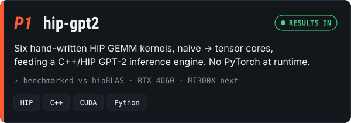
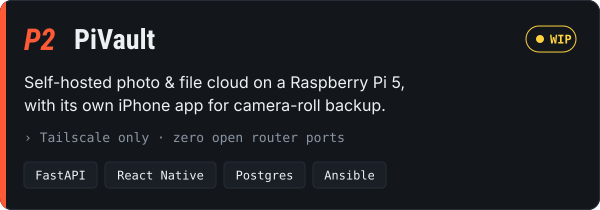
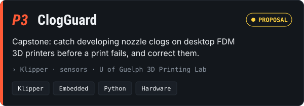
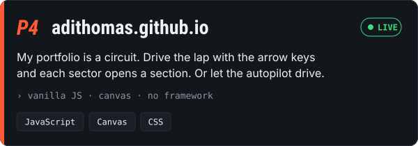
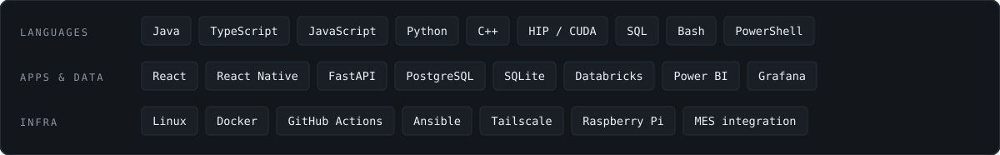

  <a href="https://adithomas.github.io"><b>🏁 Drive my portfolio</b></a> &nbsp;·&nbsp;
  <a href="https://adithomas.github.io/hip-gpt2/"><b>📈 hip-gpt2 write-up</b></a> &nbsp;·&nbsp;
  <b>🟢 Open to new-grad roles</b>

<table>
  <tr>
    <td width="50%"></td>
    <td width="50%"></td>
  </tr>
  <tr>
    <td width="50%"></td>
    <td width="50%"></td>
  </tr>
</table>

| Pos | Team | Role | Stint |
|:---:|------|------|-------|
| **1** | **Magna International** | Software Engineer: plant dashboards, full-stack tools, Databricks pipelines | Sep 2026 – now |
| 2 | Magna International | IT DevOps / Developer: CI/CD, automation, MES integration | Apr – Sep 2026 |
| 3 | City of Mississauga | IT Analyst Intern | Apr – Dec 2025 |
| 4 | ATS Corporation | IT Consultant Intern | May – Aug 2024 |

- **[Enterprise-AI-Operations-Copilot](https://github.com/AdiThomas/Enterprise-AI-Operations-Copilot)** · *WIP*. A multi-agent IT support and knowledge assistant: FastAPI, Postgres + pgvector, Redis, n8n.
- **[clogguard](https://github.com/AdiThomas/clogguard)** · *planning*. The Klipper firmware side of the capstone.
- **[F24 Algorithms & Data Structures](https://github.com/AdiThomas/F24_S1_Aditya_Thomas_Quiz2)**: coursework in Java.

Off the clock: Formula 1 (more for the strategy calls and the data than the podium), cars in general, and a self-hosted cloud on a Raspberry Pi at home.
