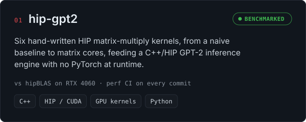
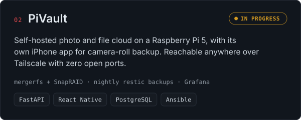
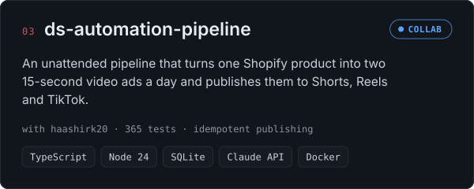
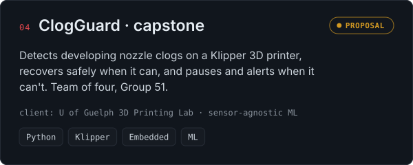
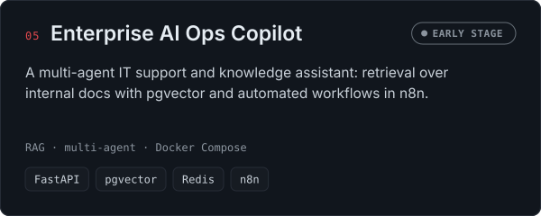
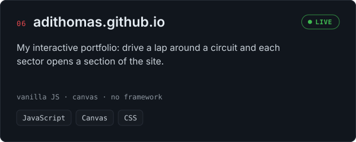
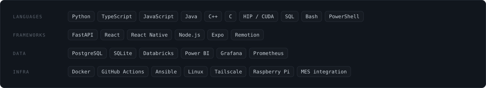

<a href="https://adithomas.github.io">
  <picture>
    <source media="(prefers-color-scheme: dark)" srcset="assets/hero-dark.svg">
    <source media="(prefers-color-scheme: light)" srcset="assets/hero-light.svg">
    
  </picture>
</a>

  
  
  
  

### Now

- **At work:** Software Engineer at Magna International, building plant-floor dashboards, full-stack tools and Databricks pipelines.
- **Building:** [PiVault](https://github.com/AdiThomas/pivault), my own photo cloud on a Raspberry Pi, and [ClogGuard](https://github.com/AdiThomas/fdm-clog-detection), our capstone.
- **Learning:** GPU performance engineering and LLM inference ([hip-gpt2](https://github.com/AdiThomas/hip-gpt2), [write-up](https://adithomas.github.io/hip-gpt2/)).
- **Looking for:** new-grad roles in software, DevOps or AI starting summer 2027. GTA or remote first, open to relocating.

### Selected work

  <a href="https://github.com/AdiThomas/hip-gpt2"><picture><source media="(prefers-color-scheme: dark)" srcset="assets/card-hip-gpt2-dark.svg"><source media="(prefers-color-scheme: light)" srcset="assets/card-hip-gpt2-light.svg"></picture></a>
  <a href="https://github.com/AdiThomas/pivault"><picture><source media="(prefers-color-scheme: dark)" srcset="assets/card-pivault-dark.svg"><source media="(prefers-color-scheme: light)" srcset="assets/card-pivault-light.svg"></picture></a>

  <a href="https://github.com/haashirk20/ds-automation-pipeline"><picture><source media="(prefers-color-scheme: dark)" srcset="assets/card-ds-automation-pipeline-dark.svg"><source media="(prefers-color-scheme: light)" srcset="assets/card-ds-automation-pipeline-light.svg"></picture></a>
  <a href="https://github.com/AdiThomas/fdm-clog-detection"><picture><source media="(prefers-color-scheme: dark)" srcset="assets/card-clogguard-dark.svg"><source media="(prefers-color-scheme: light)" srcset="assets/card-clogguard-light.svg"></picture></a>

  <a href="https://github.com/AdiThomas/Enterprise-AI-Operations-Copilot"><picture><source media="(prefers-color-scheme: dark)" srcset="assets/card-copilot-dark.svg"><source media="(prefers-color-scheme: light)" srcset="assets/card-copilot-light.svg"></picture></a>
  <a href="https://github.com/AdiThomas/AdiThomas.github.io"><picture><source media="(prefers-color-scheme: dark)" srcset="assets/card-site-dark.svg"><source media="(prefers-color-scheme: light)" srcset="assets/card-site-light.svg"></picture></a>

### Experience

| Role | Company | When |
|------|---------|------|
| **Software Engineer**: plant dashboards, full-stack tools, Databricks pipelines | **Magna International** | Sep 2026 – present |
| IT DevOps / Developer: CI/CD, automation, MES integration | Magna International | Apr – Sep 2026 |
| IT Analyst Intern | City of Mississauga | Apr – Dec 2025 |
| IT Consultant Intern | ATS Corporation | May – Aug 2024 |

### Toolkit

<picture>
  <source media="(prefers-color-scheme: dark)" srcset="assets/toolkit-dark.svg">
  <source media="(prefers-color-scheme: light)" srcset="assets/toolkit-light.svg">
  
</picture>

Off the clock: JDM cars, Formula 1 strategy, and running my own cloud on a Raspberry Pi at home. 峠
